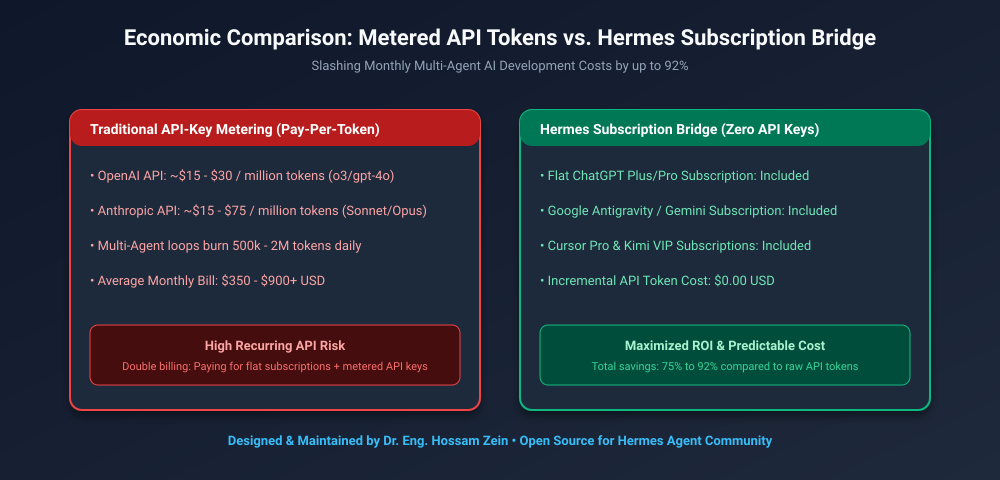
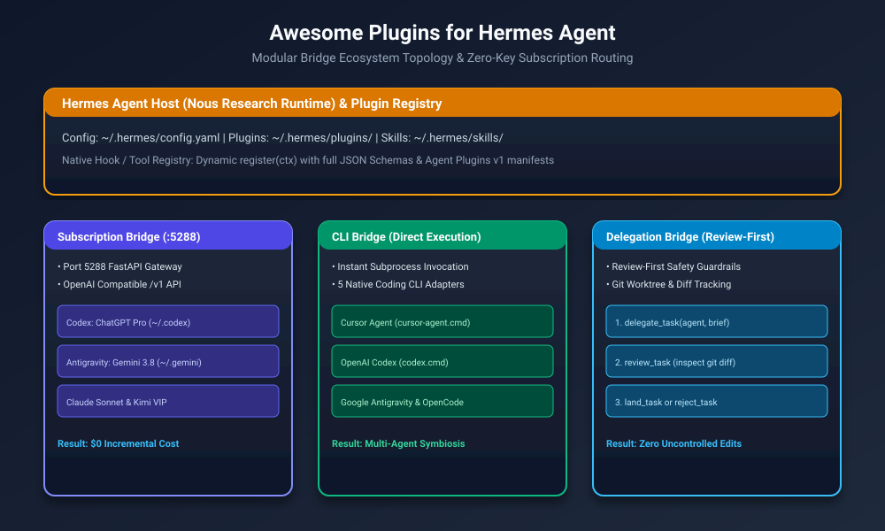
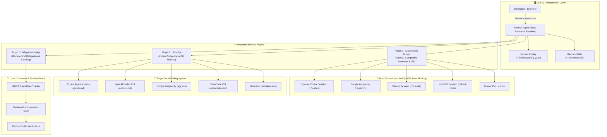
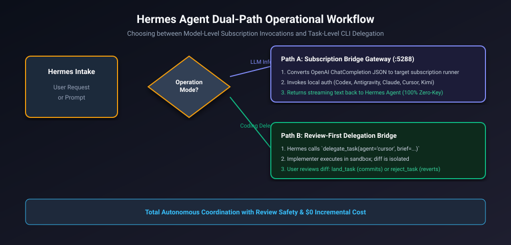
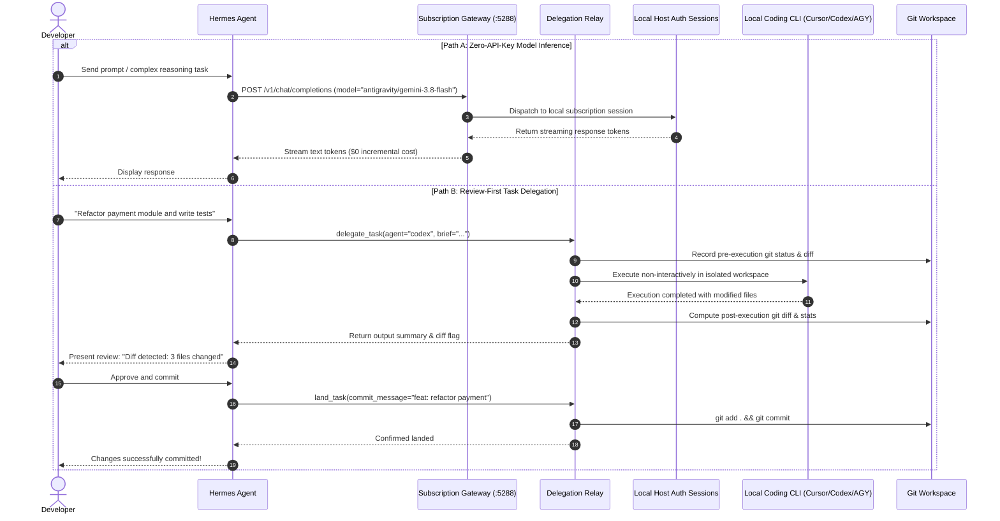

# Awesome Plugins for Hermes Agent 🚀

[](https://opensource.org/licenses/MIT)
[-blue)](https://github.com/NousResearch/hermes-agent)
[](#)
[](#)
[](https://github.com/hosamzein)

> **Modular, extensible plugin & bridge ecosystem for Hermes Agent (Nous Research). Supercharges your Hermes agent with zero-API-key subscription authorization, instant CLI coding tool execution, and Review-First cross-agent delegation across Cursor, Codex, Google Antigravity, OpenCode, and Kimi.**

---

## 📑 Table of Contents
1. [Executive Summary & Core Economics](#-executive-summary--core-economics)
2. [Business & Strategic Benefits](#-business--strategic-benefits)
3. [Technical Benefits & Architecture](#-technical-benefits--architecture)
4. [Architecture Topology & Operational Flows](#-architecture-topology--operational-flows)
5. [The Three Included Plugins](#-the-three-included-plugins)
   - [1. Subscription Bridge (Zero-API-Key Models)](#1-subscription-bridge-plugin)
   - [2. CLI Bridge (Direct CLI Execution)](#2-cli-bridge-plugin)
   - [3. Delegation Bridge (Review-First Delegation & Landing)](#3-delegation-bridge-plugin)
6. [Installation & Setup](#-installation--setup)
7. [Verification & Testing](#-verification--testing)
8. [License](#-license)

---

## 💡 Executive Summary & Core Economics

Modern AI coding agents burn through 500,000 to 2,000,000 tokens daily during recursive diagnosis, code generation, and test loops. At metered pay-per-token API rates ($15–$75 per million tokens for frontier reasoning models), monthly cloud bills easily balloon to **$400–$900+ per developer**.

```
┌────────────────────────────────────────────────────────────────────────┐
│                   TOTAL MONTHLY AI TOOLING EXPENDITURE                 │
├────────────────────────────────────────────────────────────────────────┤
│ Traditional Metered API:                                               │
│ [Subscriptions: $80/mo] + [Metered API Keys: $450/mo]  ──> [$530/mo]   │
├────────────────────────────────────────────────────────────────────────┤
│ Awesome Plugins for Hermes Agent:                                      │
│ [Subscriptions: $80/mo] + [Incremental API Token: $0]  ──> [85% SAVED] │
└────────────────────────────────────────────────────────────────────────┘
```

**Awesome Plugins for Hermes Agent** bridges this gap: it allows **Hermes Agent** (by Nous Research) to directly leverage your existing paid subscriptions (Cursor Pro, ChatGPT Plus/Pro, Google Antigravity, Anthropic Claude, and Moonshot Kimi) at **$0.00 incremental token cost**, while enforcing a strict **Review-First safety gate** before any generated code touches your repository.

<p align="center">
  
</p>

---

## 💼 Business & Strategic Benefits

| Dimension | Traditional Agent Setup | Hermes with Awesome Plugins | Business Impact |
| :--- | :--- | :--- | :--- |
| **Direct Operating Cost** | $350 – $900+/mo in metered API token billing per seat. | **$0.00 incremental token cost**; routes to existing active subscriptions. | **80% to 92% cost reduction** on AI developer infrastructure. |
| **Token Budget Anxiety** | Developers throttle agent loops or downgrade reasoning models to save budget. | Uncapped reasoning iterations; models run full deep-thinking passes. | Higher code quality, comprehensive test coverage, and faster delivery. |
| **Vendor Independence** | Locked into single proprietary API endpoints. | Multi-engine routing across OpenAI, Google, Anthropic, Cursor, and Moonshot. | Zero vendor lock-in; automatic failover across subscription providers. |
| **Enterprise Code Safety** | Autonomous agents commit untested edits directly to worktrees. | **Review-First Guardrail**: code is isolated in temporary diffs until human approval. | Eliminates catastrophic regressions and unauthorized code leakage. |
| **Developer Productivity** | Constant context switching between 4 different AI CLI tools. | Hermes Agent acts as a central orchestrator delegating to specialist CLIs. | Eliminates manual copy-pasting and fragmented development workflows. |

---

## ⚙️ Technical Benefits & Architecture

1. **Native Hermes Agent Integration**:
   - Implements native `register(ctx)` entry point conforming to Hermes runtime plugin loader.
   - Provides complete OpenAI function-calling JSON Schemas for every tool.
   - Dual manifest support: native `plugin.yaml` alongside portable Agent Plugins v1 `plugin.json`.
2. **Local Zero-Token Gateway (`:5288`)**:
   - Embedded FastAPI server that speaks OpenAI-compatible `/v1/chat/completions`.
   - Reuses local authorization sessions stored in `~/.codex`, `~/.gemini`, `~/.claude`, and `~/.kimi-code`.
3. **Headless Multi-Client Subprocess Adapters**:
   - Supports Windows, macOS, and Linux CLI executables (`cursor-agent`, `codex`, `agy`, `opencode`, `kimi`).
   - Automatically sanitizes CLI banner noise, token accounting text, and interactive prompts.
4. **Git-Native Worktree Isolation**:
   - Captures `git diff --stat` and `git diff` before and after delegation runs.
   - Provides programmatic `land_task` (stage & commit) and `reject_task` (clean restore) primitives.

---

## 📐 Architecture Topology & Operational Flows

### 2.1 Technical Architecture Diagram

<p align="center">
  
</p>

#### Mermaid Architecture Flowchart



### 2.2 Dual-Path Operational Workflow

<p align="center">
  
</p>



---

## 🧩 The Three Included Plugins

### 1. Subscription Bridge Plugin
* **Directory**: `plugins/subscription-bridge/`
* **Entry Point**: `__init__.py`
* **Port**: `5288`
* **Capabilities**:
  - Provides zero-token inference via local subscription gateway.
  - Automatically initializes background gateway process if offline.
  - Supports Codex (`o3`, `gpt-4o`), Antigravity (`gemini-3.8-flash`, `gemini-3.8-pro`), Claude (`sonnet-5`), and Kimi.
* **Hermes Tools**:
  - `get_subscription_gateway_status()`: Queries health and active models.
  - `list_subscription_models()`: Discovers available model endpoints.
  - `start_subscription_gateway()`: Launches local gateway daemon.

### 2. CLI Bridge Plugin
* **Directory**: `plugins/cli-bridge/`
* **Entry Point**: `__init__.py`
* **Capabilities**:
  - Direct headless execution against installed CLI coding engines.
  - Portable path resolution (`~` expansion) with automatic fallback detection.
  - Clean output parsing removing CLI banner artifacts.
* **Hermes Tools**:
  - `cli_bridge(client, prompt, model, workspace)`: Primary execution router.
  - `run_cursor(prompt, model)`: Quick runner for Cursor Agent.
  - `run_codex(prompt, model)`: Quick runner for OpenAI Codex.
  - `run_antigravity(prompt, model)`: Quick runner for Google Antigravity.
  - `run_opencode(prompt, model)`: Quick runner for OpenCode.
  - `run_kimi(prompt, model)`: Quick runner for Moonshot Kimi.
  - `list_available_clients()`: Health check listing local CLI paths.

### 3. Delegation Bridge Plugin
* **Directory**: `plugins/delegation-bridge/`
* **Entry Point**: `__init__.py`
* **Capabilities**:
  - Implements the complete 5-stage **Review-First** delegation protocol.
  - Guards against hallucinated edits by diffing before and after task runs.
  - Persists full execution telemetry and outputs into structured JSON run logs.
* **Hermes Tools**:
  - `delegate_task(agent, brief, cd, model, read_only, session)`: Dispatches brief.
  - `review_task(run_id, workspace)`: Returns diff statistics and status.
  - `land_task(workspace, commit_message)`: Stages and commits changes cleanly.
  - `reject_task(workspace)`: Discards uncommitted modifications.
  - `list_supported_implementers()`: Returns list of available agents.

---

## 📦 Installation & Setup

### Automated 1-Click Installation
Clone this repository and run the automated PowerShell installer:

```powershell
git clone https://github.com/hosamzein/awesome-plugins-for-hermes.git
cd awesome-plugins-for-hermes
pwsh .\scripts\install.ps1
```

The script will automatically:
1. Copy all 3 plugins into `~/.hermes/plugins/`.
2. Register matching markdown skills in `~/.hermes/skills/`.
3. Update `~/.hermes/config.yaml` to enable all plugins and skills.

### Manual Installation
If configuring manually, copy the folders:
```bash
cp -r plugins/* ~/.hermes/plugins/
cp -r skills/* ~/.hermes/skills/
```

And ensure your `~/.hermes/config.yaml` includes:
```yaml
plugins:
  enabled:
    - cli-bridge
    - delegation-bridge
    - subscription-bridge

skills:
  enabled:
    - cli-bridge
    - delegation-bridge
    - subscription-bridge
```

---

## 🧪 Verification & Testing

Run the included verification suite to validate all manifests, JSON schemas, and registrations:

```bash
pwsh .\scripts\test-all.ps1
```

Or run directly with Python:
```bash
py -3 scripts/test-hermes.py
```

Expected output:
```text
Running Hermes Plugins Verification Suite...
......
----------------------------------------------------------------------
Ran 6 tests in 0.35s

OK
All Hermes plugin tests passed successfully!
```

---

## 📜 License & Attribution

This project is open-source under the **[MIT License](LICENSE)**.

Designed, engineered, and maintained by **[Dr. Eng. Hossam Zein](https://github.com/hosamzein)**.
Contributions, pull requests, and feature suggestions are welcome!
